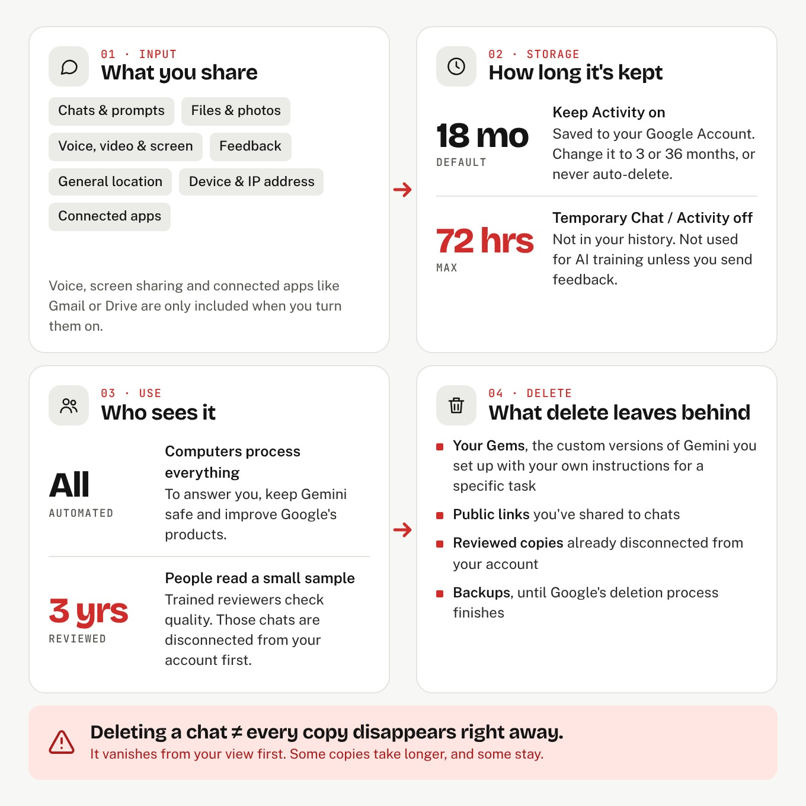

<!--
  Properties above:
  - dek: one-sentence hook shown under the title and on cards.
  - tags: first tag is the red category pill. No spaces: threat-research, data-breaches.
  - cover: drag the lead image into this folder and name it "cover", or type its file name here.
  - draft: untick (false) when it's ready, then Commit-and-sync to publish.
  - featured: tick to pin this as the big story on the home page.
  - hideFromHome: tick to keep it off the home page (still listed under Articles).
  Comments like this one never appear on the site.
-->

If you're fully googlized like me, you know how important Gmail, Docs, Slides, and Drive are to your workflow. In 2023, Google announced Gemini, its own take on generative AI. It came with frontier models and convenient integrations with the Google suite.

Gemini comes in second to ChatGPT in market share. It sold 8 million enterprise seats in four months at startup, and Gemini grew from 36% to 58% market share in 2026, against ChatGPT's 60%. Google put AI in front of billions of consumers by building it into Search and its apps. So what happens with your data?

I read the privacy policies and EULAs that no one reads, so you don't have to. Gemini's data collection goes far beyond the prompt box. Explicit collection is everything you hand over on purpose: prompts, files, photos, audio, video, screenshares, feedback, and content from connected apps like Gmail or Calendar. Implicit collection happens in the background: device and browser type, IP address, crash reports, when and how you use Gemini, and location from GPS, your IP, or saved places like home and work.

If you have Gemini write a cover letter for a job in Huntsville, it may infer your city and your career stage. Google doesn't need to sell your data to profit from it. Your data is used to sell ads.

Consent seems clear cut. Yes or No. Sadly, it isn't as simple. Texas law defines consent as a "clear affirmative act signifying a consumer's freely given, specific, informed, and unambiguous agreement to process personal data relating to the consumer." If you paste your health history into Gemini, does that count as agreeing? Google never says.

Say you get a scary diagnosis and open a Temporary Chat for privacy. You upload the lab report, and the output isn't correct. You thumbs-down the response and delete everything. That rating approves your chat and your lab results for storage on Google's servers for up to 3 years. If a reviewer picks it, your chat could outlast the deletion. You did everything correctly, and the data still stuck around.

These details are scattered across the Privacy Policy, the Gemini Privacy Hub, activity pages, retention pages, and help articles, and some of them contradict each other. The activity page says deleting a shared chat doesn't delete its public link, but the public links page says it does. Google says it doesn't sell your data or target ads based on health, religion, or sexual orientation, but everything else is fair game?

Unfortunately, you can't stop Google from collecting everything. You can make it collect a lot less:

1. **Turn on Global Privacy Control.** It tells every site you visit not to sell your data or use it for targeted ads, and Texas requires companies to honor it. 
    - Brave and DuckDuckGo have it on by default.
    - In Firefox, check the box under Settings > Privacy & Security.
    - On Chrome, Edge, or Safari, install Privacy Badger or DuckDuckGo Privacy Essentials.
    - Test it at globalprivacycontrol.org.
2. **Turn off personalized ads.** Global Privacy Control doesn't cover ads based on what you do inside Google's own apps. Go to myadcenter.google.com > Personalized ads > Off.
3. **Turn off Keep Activity.** Go to gemini.google.com > Settings & help > Activity > Turn off.
4. **Tighten your Gemini settings.**
    - Use Temporary Chat for sensitive questions.
    - Set auto-delete to 3 months.
    - Don't rate sensitive chats.
    - Disconnect unused apps.
    - Delete shared links.
    - Scrub uploads of names, addresses, and account numbers.

Gemini is extremely useful. I like its image generation, and of all the LLMs I've used, it seems to be the most creative. Nonetheless, it's data hungry. It collects far more than your prompts, infers a lot about you, and uses that for profit, and Google fails to disclose this properly. 

> [!note]
> A user who does everything right, and may even delete their Google account, still leaves behind data for years.

"Temporary" means 72 hours if you don't touch the like/dislike button, "deleted" can mean 3 years, but the fine print decides which one you get. Google gives real numbers, but there's a lot of if's and but's in Google's candy and nuts. 

Why does this matter to you? Because once you hit enter, your data stops being yours. Always remember that you don’t control how long your data lives. Google does.