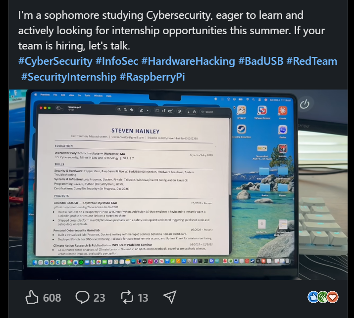

<!--
  Properties above:
  - dek: one-sentence hook shown under the title and on cards.
  - tags: first tag is the red category pill. No spaces: threat-research, data-breaches.
  - cover: drag the lead image into this folder and name it "cover", or type its file name here.
  - draft: untick (false) when it's ready, then Commit-and-sync to publish.
  - featured: tick to pin this as the big story on the home page.
  - hideFromHome: tick to keep it off the home page (still listed under Articles).
  Comments like this one never appear on the site.
-->

I just so happened upon a random post that piqued my interest on LinkedIn. I know LinkedIn! That's typically where office memes go to die.

It was a student, Steven Hainley, from Worcester Polytechnic Institute majoring in Cybersecurity with a minor in law. His post was compelling. He was showing off a simple yet ingenious BadUSB at a career fair that as soon as you plugged into any laptop in a flash it pulled up his resume and LinkedIn. 

A BadUSB is a modified USB device that is flashed with malicious firmware. It looks like a normal USB thumbdrive but can act like a keyboard, network adapter or other interfaces. This allows for covert command injection but in Steven's case just displays his resume. 

Nonetheless, it reminded me of the need to showcase your practical skills. In an era, where each job posting get on an average of 244 applications and 81% of recruiters spend under a minute on a resume.

It's easy to hear people complain about the job market but rarely do you see people want to step out of the comfort zone of the resume. The one or two pages must summarize all our capabilities. A few lines of ink, a few bytes on your hard drive must encapsulate your proficiency at the job.

That's why its a breath of fresh air when someone like Steven finds new ways to stand out. Not just doing what the other 243 applicants chose to do and send a two page pdf. 
## Let's talk numbers

## What it means

Close the story. What should the reader do or take away?
