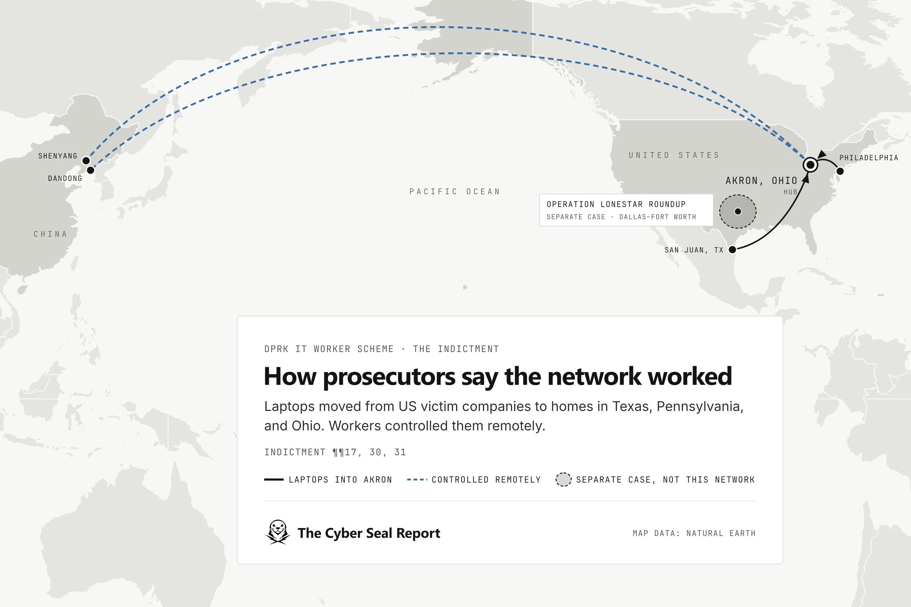
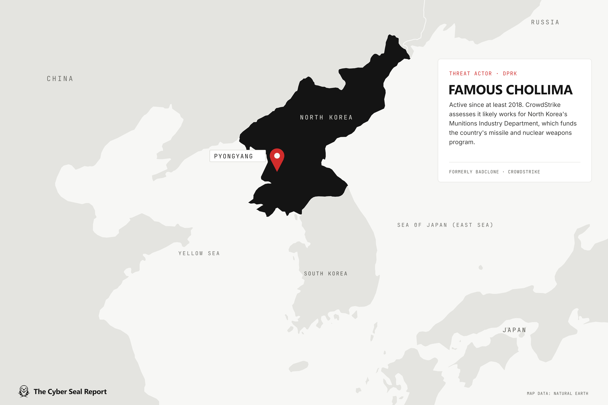

<!--
  Properties above:
  - dek: one-sentence hook shown under the title and on cards.
  - tags: first tag is the red category pill. No spaces: threat-research, data-breaches.
  - cover: drag the lead image into this folder and name it "cover", or type its file name here.
  - draft: untick (false) when it's ready, then Commit-and-sync to publish.
  - featured: tick to pin this as the big story on the home page.
  - hideFromHome: tick to keep it off the home page (still listed under Articles).
  Comments like this one never appear on the site.
-->
> [!disclosure]
> This is an ongoing case, and every defendant is presumed innocent unless and until proven guilty in court.

Forty houses in Texas. Nearly **190** laptops. None of them belonged to the people using them.

From September 21 to 25, FBI agents searched more than 40 homes across Texas. They seized laptops and remote access devices that U.S. companies had shipped to people they thought were their new employees. The Justice Department calls it Operation Lonestar Roundup.

Here’s how it works. North Korean workers land remote IT jobs at U.S. companies under stolen American names. The paychecks flow back to the regime, and prosecutors say they help fund North Korea’s weapons programs. A UN panel estimated these schemes bring in up to <u>$600 million a year</u>.

But they can’t do it alone. They need Americans to receive the laptops. The Texas raids are only half the story. On the same day the DOJ announced them, it unsealed a separate case out of Ohio. Fourteen people are charged, and two of them are Americans.

So, I'm going to answer some burning questions.

1. How are North Korean operatives getting hired as remote IT workers in <u>2026</u>?
2. How do they get past interviews and background checks?
3. Where exactly do HR and IT spot a fake hire?

Say hello to our two American co-conspirators. Juan Cecilio Pena Carrillo, 37, of San Juan, Texas. And Michael James Bostelle, 31, of Philadelphia, Pennsylvania.

Neither man is accused of hacking anything. Prosecutors say they did something more useful. They gave the scheme a home address. I'm going to call this type of person an "address mule" as this is a recent phenomenon in the cyber landscape.

Here’s what the indictment says Pena Carrillo allegedly did. Eleven laptops from various companies sitting in his house, he was paid to help the remote overseas workers access the laptops. He also let them use his name to land jobs at two or more companies.

In one instance on Jan.14, 2025, someone sat for an interview claiming to be Pena Carillo. He got the offer and then later got fired for too many excuses for missing meetings. These state actors were not only tricky but smart. They'd have multiple people sit with the same name in order to maximize the chance of getting an offer. 

EIGHT people using Pena Carillo's identity got jobs at U.S. companies. In the indictment papers, four of the victim companies stated that they paid about $78,735 into Pena's accounts.

However, they didn't just use Pena's name. The group had scores of stolen US identities with an enhanced AI stock photo to look more legitimate which would help them get past recruiters. 

Michael Bostelle's role was more of a middle man who was paid to receive laptops in Pennsylvania and ship them out to the Ohio laptop farm. This Ohio farm turned out to be the central hub of North Korean conspiracy. Prosecutors say the scheme hit more than 70 U.S. companies and brought in more than <u>$3 million</u> for the group. 

Now we have this mystery man. Trey Michael Nolte is ALL over this Ohio indictment. He lives near Akron Ohio. His past is odd and his direct connection to this case ties a more complex knot. According to his LinkedIn, he's been a freelancer for seventeen years and an Owner of Dark Falls LLC for five.

Dark Falls is publicly presented as a game art studio. The indictment calls it a "shell company" a front for the scheme. Nolte in his own words says that he's a "passionate game artist and 3D modeler." The company's Facebook page has two followers and a small hand drawn logo presumably by Nolte.

Trey Nolte has somehow miraculously not been charged and I have no clue why. It should be clear that this is all alleged. Nevertheless, the indictment if true is pretty damning. 

Laptops from the US companies came to his Ohio house. Some straight from the companies to his door. Others came through Americans like the middleman, Bostelle. Workers in Dandong remotely logged in from overseas into the laptops in his Ohio home. Nolte kept in touch with them by text, email, and Discord.

So secondly, how do they get past interviews and background checks?

The background check usually comes back clean. The names belong to real Americans whose identities were stolen. So the paperwork isn’t the hard part. That's where Nolte played a role.

First, he gave the fakes a past. In 2021, a handler told him to sit for an interview and vouch for a fake worker’s job history. He complained he was “tired of always lying to companies.” Then he did it anyway. 

Next, he gave them a phone number. Nolte set up four U.S. phone numbers so the applicants looked local. In 2025 allegedly, a handler gave him a stolen Texas identity to activate a Nokia phone. Its job was to supply a U.S. number for verification codes.

Then he gave them a location. A handler told him to set up laptops that showed U.S. IP addresses, in case a company checked where its new hire was. 

But what if a company that wanted to meet face to face? No problem, a handler told Nolte in 2024 to hire an actor to play the applicant at an in-person interview in Akron.  A year later, he was told to buy ads to recruit actors. He was to pay for them with a stolen credit card.

The workers also were typically employed by more than one US company. This helped maximize revenue and reach.

Let me be clear. These were not hard working Koreans down on their luck in the job market. Their paychecks help fund North Korea's weapons program. Some use their access for worse.

In CrowdStrike's 2026 report, the company found that North Korean hackers posing as remote IT workers or online recruiters made up about <u>half of all documented "hands-on-keyboard" intrusions at U.S. tech companies</u>. (Hands-on-keyboard means there is a human attacker directly involved.)

CrowdStrike calls the group Famous Chollima. A chollima is a winged horse from Korean myth, and CrowdStrike tags North Korean groups with the name. Famous Chollima lands remote IT jobs and sends the pay to Pyongyang. CrowdStrike tracked more than 320 cases in one year, up 220%. From April 2025 to May 2026, it made up 47% of state-backed activity aimed at tech. The DOJ doesn’t use the name. But this case follows their M.O. however I have no evidence linking to them as of yet.

So one must admit, this is a clever ruse. How can IT and HR account for this type of fraud?

That’s the first question I ask. I work the help desk. I’m the one who preps a remote hire’s laptop, ships it, and makes sure the user can login. Our own Info-Security team has reached out to me to see why sign-in logs are strange. Typically its just a VPN that trips our system. So unfortunately, there's a number of false positives to consider.

But most fake hires trip up with at least one of three spots.

1. **When it ships.**
HR sees this one first. The laptop goes somewhere other than the home address on file. If a new hire changes their address at the last minute, this should be flagged. The handlers in the Ohio case kept a list of the companies that shipped to Nolte, so no company sent two laptops to one house. 

2. **When it enrolls.**
This is IT's turf. Strict security policies and alerts should be setup to prevent remote access tools. The FBI names AnyDesk, TeamViewer, RustDesk, Chrome Remote Desktop, and Splashtop. One hire using Pena Carrillo’s name started on Feb 4, 2025. By Feb 10, three of those tools were on the laptop.

3. **When it phones home.**
Look at sign-ins, not only the IP. Nolte set up laptops to show U.S. addresses. Yet MFA approvals from a China Mobile IP still went through about 95% of the time. 

Conditional and GPS-based access in Microsoft Entra ID or Okta Identity Threat Protection can help to block these logins by checking the  phone's real-time GPS coordinates and ASN against the laptop's U.S. session.

The fix is stacking the flags. For a new remote hire’s first 30 days, HR and IT compare three things each week.

1. *Does the shipping address match the home address?*
2. *Are remote access tools on the laptop?*
3. *Do the sign-ins match the place they claim to live?*

One yes is noise. Two is a phone call.

Most weeks, I box up a laptop for someone I’ve never met. I tape it shut, print the label, and trust that it lands where it should.

That trust is what this scheme runs on.

The stolen name passes the background check. A rented phone number answers the call. A laptop farm supplies the U.S. IP. When a company wants to meet in person, an actor shows up.

But someone still has to sign for the box.

That’s the address mule. Prosecutors say Pena Carrillo did it in Texas and Bostelle did it in Pennsylvania. The indictment puts Nolte allegedly at the center in Ohio.

The handlers knew it was their weak spot. They kept a list so no company would ship two laptops to the same house.

Each of those is a seam. On its own, each one looks like a normal remote hire. 

No single team sees them all. HR sees the address. I see the laptop. Security sees the sign-ins. The catch happens when we compare notes.

